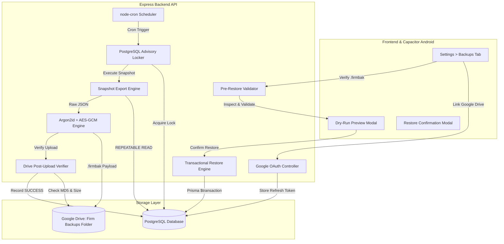
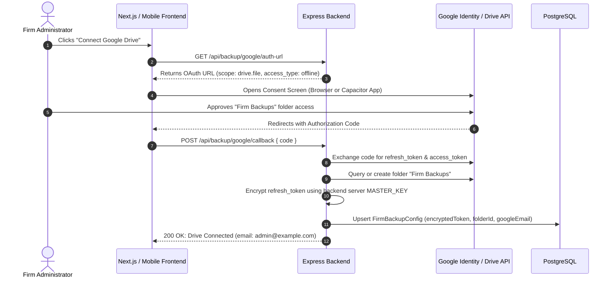
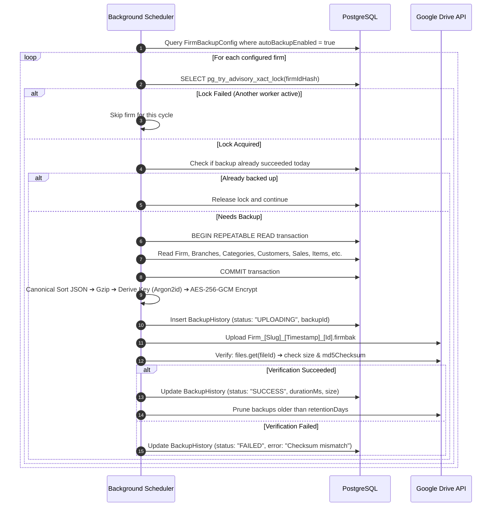
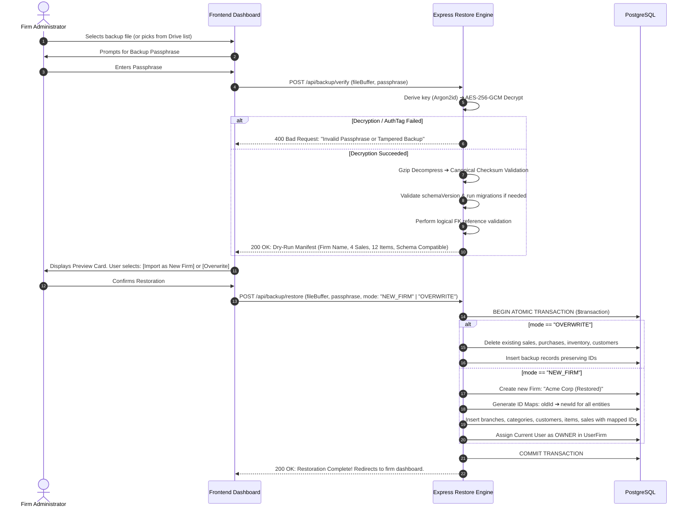

# Implementation Blueprint: Production-Grade Encrypted Google Drive Backup & Firm Restore Engine

Comprehensive architecture, security specifications, and step-by-step roadmap for automated, zero-corruption, zero-knowledge encrypted Google Drive backups and transactional firm restoration in the Firm platform.

---

## Table of Contents
1. [Architectural Principles & Hardened Security Model](#1-architectural-principles--hardened-security-model)
   - [A. Self-Contained Point-in-Time Snapshots vs Incremental Chains](#a-self-contained-point-in-time-snapshots-vs-incremental-chains)
   - [B. Cryptographic Hardening: Argon2id + AES-256-GCM](#b-cryptographic-hardening-argon2id--aes-256-gcm)
   - [C. True Zero-Knowledge & Credential Isolation](#c-true-zero-knowledge--credential-isolation)
   - [D. Zero-Metadata-Leakage Envelope](#d-zero-metadata-leakage-envelope)
   - [E. Schema Evolution & Migration Pipeline](#e-schema-evolution--migration-pipeline)
   - [F. Concurrency Control & Idempotent Scheduling (Advisory Locks)](#f-concurrency-control--idempotent-scheduling-advisory-locks)
   - [G. Database Snapshot Integrity (Single Transaction Client)](#g-database-snapshot-integrity-single-transaction-client)
   - [H. Post-Upload Verification Pipeline](#h-post-upload-verification-pipeline)
   - [I. Pre-Restore Dry-Run & Two-Phase Restoration](#i-pre-restore-dry-run--two-phase-restoration)
2. [End-to-End System Flows & Diagrams](#2-end-to-end-system-flows--diagrams)
   - [A. Global Architecture Flow](#a-global-architecture-flow)
   - [B. Google Drive OAuth & Credential Isolation Flow](#b-google-drive-oauth--credential-isolation-flow)
   - [C. Automated Daily Backup Flow (with Advisory Locking & Verification)](#c-automated-daily-backup-flow-with-advisory-locking--verification)
   - [D. Restore Flow: Download ➔ Verify (Dry Run) ➔ Atomic Restore](#d-restore-flow-download--verify-dry-run--atomic-restore)
3. [Container Specification: `.firmbak` Format v2](#3-container-specification-firmbak-format-v2)
4. [Step-by-Step Implementation Roadmap](#4-step-by-step-implementation-roadmap)
   - [Phase 1: Database Schema Expansion (Prisma)](#phase-1-database-schema-expansion-prisma)
   - [Phase 2: Hardened Cryptographic Engine (`argon2` + `aes-256-gcm`)](#phase-2-hardened-cryptographic-engine-argon2--aes-256-gcm)
   - [Phase 3: Snapshot Export Engine (Single `REPEATABLE READ` Client)](#phase-3-snapshot-export-engine-single-repeatable-read-client)
   - [Phase 4: Google Drive Client & Post-Upload Verifier](#phase-4-google-drive-client--post-upload-verifier)
   - [Phase 5: Concurrency-Safe Scheduler & Advisory Lock Engine](#phase-5-concurrency-safe-scheduler--advisory-lock-engine)
   - [Phase 6: Schema Migration Layer & Dry-Run Validator](#phase-6-schema-migration-layer--dry-run-validator)
   - [Phase 7: Two-Phase Restore Engine (Bulk Insert & ID Remapping)](#phase-7-two-phase-restore-engine-bulk-insert--id-remapping)
   - [Phase 8: Backend API Surface & Session Progress](#phase-8-backend-api-surface--session-progress)
   - [Phase 9: Frontend Settings & Restore UI](#phase-9-frontend-settings--restore-ui)
5. [Error Handling, Failure Recovery & Edge Cases](#5-error-handling-failure-recovery--edge-cases)
6. [Verification, Benchmarking & Testing Matrix](#6-verification-benchmarking--testing-matrix)

---

## 1. Architectural Principles & Hardened Security Model

### A. Self-Contained Point-in-Time Snapshots vs Incremental Chains

> **The Question:** *"Today 2 sale vouchers were created. Tomorrow 2 more are added. How does backup mode handle this without corrupting data?"*

In business ERP and accounting systems (e.g., Tally, SAP, QuickBooks), **differential or incremental chains are an anti-pattern**:
- If Day 2's delta file is lost, corrupted, or deleted in Google Drive, Day 3 and Day 4 cannot be restored.
- An incremental merge requires replaying sequences of writes, which easily suffers foreign key desynchronization if masters are modified.

**The Solution: Independent Encrypted Snapshots**
1. **Day 1 Snapshot (`Firm_Alpha_2026-10-06_02-00_<backupId>.firmbak`):**
   - Captures the firm's entire active state: Sales #1 and #2, customers, inventory, branches, categories.
2. **Day 2 Snapshot (`Firm_Alpha_2026-10-07_02-00_<backupId>.firmbak`):**
   - Captures the firm's entire active state at Day 2: Sales #1, #2, #3, and #4, plus any edits, payments, and stock changes.
3. **Payload Size vs Value:**
   - JSON data for 25,000 sales vouchers and 100,000 line items compressed with Gzip is only **~2 to 5 MB**.
   - Because snapshots are tiny, taking a full snapshot once daily is fast (~1–2 seconds) and guarantees that **every backup file is 100% self-sufficient**. Any single file can restore the firm independently without needing any prior history.
4. **Automated Pruning:**
   - Retain daily snapshots for 7 days, weekly for 4 weeks, and prune older files in Google Drive automatically.

---

### B. Cryptographic Hardening: Argon2id + AES-256-GCM

#### Why NOT PBKDF2?
Backup files are downloaded to user computers and uploaded to Google Drive. If a backup file is obtained by an adversary, they can run offline brute-force or dictionary attacks on GPUs and ASICs. PBKDF2 (even at 100,000 iterations) is computationally cheap to parallelize on GPUs.

#### The Argon2id Standard
We use **Argon2id** (the winner of the Password Hashing Competition), which combines memory-hardness (defeating GPU/ASIC parallelization) with resistance to cache-timing side-channel attacks.

```
User Passphrase
       │
       ▼
Argon2id (Memory: 64 MB, Iterations: 3, Parallelism: 4)  [~150–250 ms delay]
       │
       ▼
256-bit Symmetric Key
       │
       ▼
Plaintext JSON ──► Canonical Sort ──► Gzip ──► AES-256-GCM (12-byte IV)
                                                       │
                                                       ▼
                                         Ciphertext + 16-byte AuthTag
```

- **Tuned for Responsive Operations:**
  Parameters: `memoryCost: 65536` (64 MB RAM), `timeCost: 3` (3 iterations), `parallelism: 4`.
  Execution time: ~150–300 ms on server CPU.
  Because key derivation runs **once per backup generation or once per restore session**, this slight delay is completely imperceptible to users while making offline password cracking thousands of times more expensive for attackers.

---

### C. True Zero-Knowledge & Credential Isolation

We maintain an absolute separation between the cloud storage layer and the data encryption layer:

```
┌─────────────────────────────────┐       ┌─────────────────────────────────┐
│     Google OAuth Subsystem      │       │     Firm Encryption Engine      │
├─────────────────────────────────┤       ├─────────────────────────────────┤
│ • Google Refresh Token          │       │ • User Backup Passphrase        │
│ • Stored in DB (Encrypted by    │       │ • NEVER stored in DB            │
│   Backend Server MASTER_KEY)    │       │ • NEVER logged to disk          │
│ • Grants access to Drive folder │       │ • Generates Argon2id Key        │
└────────────────┬────────────────┘       └────────────────┬────────────────┘
                 │                                         │
                 ▼                                         ▼
         Google Drive Access                       Encrypt / Decrypt Payload
```

#### Elimination of `passphraseVerifier`
- **Zero-Knowledge Principle:** The backend database stores **zero persistent material** derived from the backup passphrase.
- **Self-Verifying Container:** We do NOT need a database hash to verify whether a passphrase is correct. AES-256-GCM produces a 16-byte `authTag`. If the wrong passphrase is entered:
  1. The derived key will differ.
  2. `decipher.final()` throws an immediate authentication failure.
  3. Decryption halts before decompressing or parsing anything.

---

### D. Zero-Metadata-Leakage Envelope

In early designs, the `.firmbak` header exposed `firmName`, `salesCount`, and `customersCount` in plaintext. If an attacker intercepts the file, they learn business turnover indicators and company identity without breaking encryption.

**Format v2 Rule: Complete Metadata Privacy**
The unencrypted outer envelope contains **only cryptographic parameters**:
- `magic: "FIRMBAK"`
- `formatVersion: 2`
- `crypto`: KDF parameters (`argon2id`, salt, memory, iterations, parallelism), IV, and GCM authTag.
- `payload`: Base64 ciphertext.

All sensitive metadata (`backupId`, `firmId`, `firmName`, `schemaVersion`, `createdAt`, `manifest`, and table rows) lives **strictly inside the encrypted payload**.

---

### E. Schema Evolution & Migration Pipeline

Database structures change over time (e.g. adding `salesmanId`, altering tax structures, introducing discount rules). An accounting backup from 6 months ago must still be restorable on future software versions.

We decouple two versions:
1. `formatVersion` (Integer): Defines how the `.firmbak` envelope file itself is formatted and encrypted.
2. `schemaVersion` (Integer): Defines the database schema generation of the internal entity payload.

```
.firmbak (schemaVersion: 1)
           │
           ▼
Detect Backup Schema Version (v1) vs Current DB Schema Version (v3)
           │
           ▼
Run Migration 1 ➔ 2: e.g. Assign default taxProfileId if missing
           │
           ▼
Run Migration 2 ➔ 3: e.g. Split customer address into street/city/pincode
           │
           ▼
Payload now matches current DB schema ➔ Safe Transactional Restore
```

---

### F. Concurrency Control & Idempotent Scheduling (Advisory Locks)

When running scheduled backups across multiple server instances (or when a user clicks "Backup Now" while an automatic backup is executing), race conditions can cause duplicate backups.

#### PostgreSQL Advisory Locks
Before executing any firm backup, the worker must acquire an explicit PostgreSQL transactional advisory lock:

```sql
SELECT pg_try_advisory_xact_lock(hashtext('backup_' || $firmId));
```

- If `pg_try_advisory_xact_lock` returns `false`, another instance or manual trigger is already executing a backup for that firm. The process gracefully skips or waits.
- The lock automatically releases when the transaction commits or aborts.

#### Unique `backupId` (UUID) & Idempotency
- Every backup generates a cryptographically random `backupId: "uuidv4"`.
- Filename format: `Firm_<firmSlug>_<YYYY-MM-DD_HH-mm>_<backupIdPrefix>.firmbak`.
- `BackupHistory` tracks `backupId`. If a scheduler process crashes after uploading to Google Drive but before updating the database, the next run verifies whether `backupId` exists in Drive and prevents duplicate creation.

---

### G. Database Snapshot Integrity (Single Transaction Client)

To guarantee that the backup does not read half-written records or desynchronized data:
1. All table queries during export are executed using a **single transaction client**:
   `prisma.$transaction(async (tx) => { ... }, { isolationLevel: Prisma.TransactionIsolationLevel.RepeatableRead })`.
2. `REPEATABLE READ` ensures all `SELECT` queries across `Firm`, `Branch`, `Customer`, `Sale`, `SaleItem`, and `Inventory` read from the **exact same frozen snapshot moment**.
3. No rogue independent queries (`Promise.all([prisma.sale.findMany(), ...])`) are allowed. Everything queries through `tx`.

---

### H. Post-Upload Verification Pipeline

An upload request returning `200 OK` from Google Drive does not guarantee complete data durability. The backup job enters `VERIFYING` state and confirms the upload before marking `SUCCESS`:

1. **Verify Existence:** Query Google Drive API `files.get` for the uploaded `fileId`.
2. **Verify Size:** Assert `driveFile.size === localBuffer.length`.
3. **Verify Checksum:** Google Drive calculates and returns `md5Checksum`. Verify that `md5(localBuffer) === driveFile.md5Checksum`.
4. Only when all three pass is `BackupHistory` transitioned to `SUCCESS`.

---

### I. Pre-Restore Dry-Run & Two-Phase Restoration

Restoring accounting data is high-stakes. Before executing destructive database writes, the system supports a **Two-Phase Dry-Run**:

```
Step 1: POST /api/backup/verify (Dry-Run Preview)
  • Decrypts with Argon2id + AES-GCM
  • Checks schemaVersion & compatibility
  • Validates logical integrity (e.g. Sale.customerId references a valid customer)
  • Returns Preview JSON to UI:
    {
      "valid": true,
      "firmName": "Acme Corp",
      "createdAt": "2026-10-06T14:30:00Z",
      "manifest": { "branches": 2, "sales": 4, "saleItems": 12, "customers": 6 },
      "warnings": []
    }

Step 2: POST /api/backup/restore (User confirms action)
  • Option A: "Import as New Firm" (Clones with new IDs, zero risk to current firm)
  • Option B: "Overwrite Existing Firm" (Destructive rollback; requires confirmation prompt)
```

---

## 2. End-to-End System Flows & Diagrams

### A. Global Architecture Flow



---

### B. Google Drive OAuth & Credential Isolation Flow



---

### C. Automated Daily Backup Flow (with Advisory Locking & Verification)



---

### D. Restore Flow: Download ➔ Verify (Dry Run) ➔ Atomic Restore



---

## 3. Container Specification: `.firmbak` Format v2

The file uses a **strict binary-safe JSON envelope**. Notice that all business metadata (firm names, sales figures, customer counts) is strictly inside the encrypted payload to prevent metadata leaks.

```json
{
  "magic": "FIRMBAK",
  "formatVersion": 2,
  "crypto": {
    "kdf": "argon2id",
    "kdfParams": {
      "memoryCost": 65536,
      "timeCost": 3,
      "parallelism": 4
    },
    "salt": "u8A3+vN82L3xKj1mP90qZg==",
    "cipher": "aes-256-gcm",
    "iv": "X9k1A3bQmN82kL90",
    "authTag": "mNp20xL8v9A3kL90mNp20w==",
    "compressedSha256": "8f434346648f6b96df89dda901c5176b10a6d83961dd3c1ac88b59b2dc327aa4"
  },
  "payload": "H4sICDYX..."
}
```

### Encrypted & Gzipped Plaintext Structure
Once decrypted with the derived Argon2id key and decompressed with Gzip, the internal JSON adheres to:

```json
{
  "backupId": "f47ac10b-58cc-4372-a567-0e02b2c3d479",
  "firmId": "cm823901b000008l41b",
  "firmName": "Kush Patel Enterprises",
  "schemaVersion": 1,
  "createdAt": "2026-10-06T20:30:00.000Z",
  "generator": "Firm-Core-v1.0",
  "manifest": {
    "branches": 2,
    "sales": 4,
    "saleItems": 12,
    "purchases": 3,
    "purchaseItems": 9,
    "customers": 6,
    "suppliers": 4,
    "inventoryItems": 25,
    "categories": 3,
    "expenses": 5,
    "deliveryChallans": 2
  },
  "data": {
    "firm": { "name": "Kush Patel Enterprises", "currency": "INR", "timezone": "Asia/Kolkata", "businessType": "Retail" },
    "branches": [ ... ],
    "categories": [ ... ],
    "customers": [ ... ],
    "suppliers": [ ... ],
    "inventoryItems": [ ... ],
    "sales": [
      {
        "id": "sale_1",
        "invoiceNumber": "INV-2026-001",
        "customerId": "cust_1",
        "branchId": "branch_1",
        "date": "2026-10-05T10:00:00.000Z",
        "subtotal": 5000,
        "tax": 900,
        "total": 5900,
        "status": "CONFIRMED",
        "saleType": "PAKU",
        "items": [
          { "name": "Standard Fitting", "quantity": 2, "unitPrice": 2500, "total": 5000 }
        ]
      }
    ],
    "purchases": [ ... ],
    "expenses": [ ... ],
    "deliveryChallans": [ ... ]
  }
}
```

---

## 4. Step-by-Step Implementation Roadmap

### Phase 1: Database Schema Expansion (Prisma)
Update [database/prisma/schema.prisma](file:///c:/Users/k4kus/Documents/Firm/database/prisma/schema.prisma) with backup tracking models:

```prisma
// ──────────────────────────────────────────────
// Backup & Cloud Synchronization
// ──────────────────────────────────────────────

enum BackupStatus {
  QUEUED
  RUNNING
  UPLOADING
  VERIFYING
  SUCCESS
  FAILED
  AUTH_EXPIRED
  CANCELLED
}

enum BackupActionType {
  AUTO_SCHEDULED
  MANUAL_EXPORT
  RESTORE_OVERWRITE
  RESTORE_NEW_FIRM
}

/// Stores Google Drive OAuth configuration and backup schedule per firm
model FirmBackupConfig {
  id                  String       @id @default(cuid())
  firmId              String       @unique
  firm                Firm         @relation(fields: [firmId], references: [id], onDelete: Cascade)

  // Google Drive Credentials (Encrypted at rest with backend MASTER_KEY)
  googleEmail         String?
  googleRefreshToken  String?      // Encrypted token for background scheduling
  googleFolderId      String?      // ID of "Firm Backups" folder

  // Automation Schedule
  autoBackupEnabled   Boolean      @default(false)
  backupTime          String       @default("02:00") // HH:MM 24-hr format
  timezone            String       @default("Asia/Kolkata")
  retentionDays       Int          @default(30)

  // Audit of execution
  lastBackupAt        DateTime?
  lastBackupStatus    BackupStatus?
  lastError           String?

  createdAt           DateTime     @default(now())
  updatedAt           DateTime     @updatedAt

  @@map("firm_backup_configs")
}

/// Immutable audit record of every backup and restore event
model BackupHistory {
  id              String           @id @default(cuid())
  backupId        String           @unique // Unique UUID for idempotency
  firmId          String
  firm            Firm             @relation(fields: [firmId], references: [id], onDelete: Cascade)

  actionType      BackupActionType
  status          BackupStatus
  fileName        String?
  fileSizeBytes   Int?
  googleFileId    String?
  manifest        Json?            // Summary counts: { sales: 4, items: 12, ... }
  durationMs      Int?
  errorMessage    String?

  createdAt       DateTime         @default(now())

  @@index([firmId, createdAt(sort: Desc)])
  @@index([backupId])
  @@map("backup_histories")
}
```

Execute migration:
```bash
npm run db:migrate
```

---

### Phase 2: Hardened Cryptographic Engine (`argon2` + `aes-256-gcm`)

Install dependencies in `backend`:
```bash
cd backend && npm install argon2 fast-json-stable-stringify
```

Create `backend/src/utils/backup-crypto.js`:

```javascript
const crypto = require("crypto");
const zlib = require("zlib");
const argon2 = require("argon2");
const stringify = require("fast-json-stable-stringify");

const KDF_CONFIG = {
  type: argon2.argon2id,
  memoryCost: 65536, // 64 MB
  timeCost: 3,        // 3 iterations
  parallelism: 4,     // 4 threads
  hashLength: 32,     // 256-bit AES key
};

/**
 * Derives a 256-bit symmetric key from passphrase and salt using Argon2id.
 */
async function deriveKey(passphrase, saltBuffer) {
  const hash = await argon2.hash(passphrase, {
    ...KDF_CONFIG,
    salt: saltBuffer,
    raw: true,
  });
  return hash;
}

/**
 * Encrypts data object into .firmbak envelope format v2.
 */
async function encryptBackupPayload(dataObject, passphrase) {
  // 1. Deterministic JSON serialization
  const canonicalJson = stringify(dataObject);

  // 2. Gzip compression
  const compressed = zlib.gzipSync(Buffer.from(canonicalJson, "utf8"));
  const compressedSha256 = crypto.createHash("sha256").update(compressed).digest("hex");

  // 3. Cryptographic primitives
  const salt = crypto.randomBytes(32);
  const iv = crypto.randomBytes(12); // Standard 96-bit IV for GCM
  const key = await deriveKey(passphrase, salt);

  // 4. AES-256-GCM encryption
  const cipher = crypto.createCipheriv("aes-256-gcm", key, iv);
  const encrypted = Buffer.concat([cipher.update(compressed), cipher.final()]);
  const authTag = cipher.getAuthTag();

  return {
    magic: "FIRMBAK",
    formatVersion: 2,
    crypto: {
      kdf: "argon2id",
      kdfParams: {
        memoryCost: KDF_CONFIG.memoryCost,
        timeCost: KDF_CONFIG.timeCost,
        parallelism: KDF_CONFIG.parallelism,
      },
      salt: salt.toString("base64"),
      cipher: "aes-256-gcm",
      iv: iv.toString("base64"),
      authTag: authTag.toString("base64"),
      compressedSha256,
    },
    payload: encrypted.toString("base64"),
  };
}

/**
 * Decrypts .firmbak envelope format v2. Fails immediately if key is wrong or data tampered.
 */
async function decryptBackupPayload(envelope, passphrase) {
  if (envelope.magic !== "FIRMBAK") {
    throw new Error("Invalid backup container: unrecognized magic header");
  }
  if (envelope.formatVersion !== 2) {
    throw new Error(`Unsupported container format version: ${envelope.formatVersion}`);
  }

  const { salt, iv, authTag, compressedSha256 } = envelope.crypto;
  const saltBuf = Buffer.from(salt, "base64");
  const ivBuf = Buffer.from(iv, "base64");
  const authTagBuf = Buffer.from(authTag, "base64");
  const ciphertextBuf = Buffer.from(envelope.payload, "base64");

  // 1. Re-derive key
  const key = await deriveKey(passphrase, saltBuf);

  // 2. AES-256-GCM Decipher
  const decipher = crypto.createDecipheriv("aes-256-gcm", key, ivBuf);
  decipher.setAuthTag(authTagBuf);

  let compressed;
  try {
    compressed = Buffer.concat([decipher.update(ciphertextBuf), decipher.final()]);
  } catch (err) {
    throw new Error("Decryption failed: invalid passphrase or corrupted/tampered file");
  }

  // 3. Checksum verification
  const actualHash = crypto.createHash("sha256").update(compressed).digest("hex");
  if (actualHash !== compressedSha256) {
    throw new Error("Integrity check failed: compressed SHA-256 checksum mismatch");
  }

  // 4. Decompression
  const jsonStr = zlib.gunzipSync(compressed).toString("utf8");
  return JSON.parse(jsonStr);
}

module.exports = {
  encryptBackupPayload,
  decryptBackupPayload,
};
```

---

### Phase 3: Snapshot Export Engine (Single `REPEATABLE READ` Client)

Create `backend/src/services/backup-export.service.js`:

```javascript
const prisma = require("../config/database");
const { Prisma } = require("@prisma/client");
const crypto = require("crypto");

const CURRENT_SCHEMA_VERSION = 1;

/**
 * Exports all firm data using a single REPEATABLE READ snapshot transaction.
 */
async function exportFirmSnapshot(firmId) {
  return await prisma.$transaction(
    async (tx) => {
      // 1. Fetch Firm details
      const firm = await tx.firm.findUnique({
        where: { id: firmId },
        select: {
          id: true,
          name: true,
          businessType: true,
          currency: true,
          timezone: true,
          gstNumber: true,
          address: true,
          phone: true,
        },
      });

      if (!firm) throw new Error("Firm not found");

      // 2. Fetch all dependent operational entities through the SAME tx client
      const branches = await tx.branch.findMany({ where: { firmId } });
      const categories = await tx.category.findMany({
        where: { firmId },
        include: {
          subtypes: true,
          dimensions: true,
          sizePresets: true,
          pricingRules: true,
        },
      });
      const customers = await tx.customer.findMany({ where: { firmId } });
      const suppliers = await tx.supplier.findMany({ where: { firmId } });
      const inventoryItems = await tx.inventoryItem.findMany({ where: { firmId } });
      const sales = await tx.sale.findMany({
        where: { firmId },
        include: { items: true },
      });
      const purchases = await tx.purchase.findMany({
        where: { firmId },
        include: { items: true },
      });
      const expenses = await tx.expense.findMany({ where: { firmId } });
      const deliveryChallans = await tx.deliveryChallan.findMany({ where: { firmId } });

      const totalSaleItems = sales.reduce((acc, s) => acc + s.items.length, 0);
      const totalPurchaseItems = purchases.reduce((acc, p) => acc + p.items.length, 0);

      const backupId = crypto.randomUUID();

      return {
        backupId,
        firmId: firm.id,
        firmName: firm.name,
        schemaVersion: CURRENT_SCHEMA_VERSION,
        createdAt: new Date().toISOString(),
        manifest: {
          branches: branches.length,
          categories: categories.length,
          customers: customers.length,
          suppliers: suppliers.length,
          inventoryItems: inventoryItems.length,
          sales: sales.length,
          saleItems: totalSaleItems,
          purchases: purchases.length,
          purchaseItems: totalPurchaseItems,
          expenses: expenses.length,
          deliveryChallans: deliveryChallans.length,
        },
        data: {
          firm,
          branches,
          categories,
          customers,
          suppliers,
          inventoryItems,
          sales,
          purchases,
          expenses,
          deliveryChallans,
        },
      };
    },
    {
      isolationLevel: Prisma.TransactionIsolationLevel.RepeatableRead,
      timeout: 30000,
    }
  );
}

module.exports = {
  exportFirmSnapshot,
  CURRENT_SCHEMA_VERSION,
};
```

---

### Phase 4: Google Drive Client & Post-Upload Verifier

Create `backend/src/services/google-drive.service.js`:

```javascript
const { google } = require("googleapis");
const crypto = require("crypto");
const stream = require("stream");
const config = require("../config/env");
const { decryptSecret } = require("../utils/token-encryptor");

function getDriveClient(refreshToken) {
  const oauth2Client = new google.auth.OAuth2(
    config.googleClientId,
    config.googleClientSecret,
    config.googleRedirectUri
  );
  oauth2Client.setCredentials({ refresh_token: decryptSecret(refreshToken) });
  return google.drive({ version: "v3", auth: oauth2Client });
}

/**
 * Uploads backup envelope and executes post-upload verification.
 */
async function uploadAndVerifyBackup(driveClient, folderId, fileName, fileBuffer) {
  const bufferStream = new stream.PassThrough();
  bufferStream.end(fileBuffer);

  // 1. Upload
  const uploadRes = await driveClient.files.create({
    requestBody: {
      name: fileName,
      parents: [folderId],
      mimeType: "application/json",
    },
    media: {
      mimeType: "application/json",
      body: bufferStream,
    },
    fields: "id, name, size, md5Checksum",
  });

  const file = uploadRes.data;

  // 2. Post-Upload Verification
  const expectedSize = fileBuffer.length;
  const actualSize = parseInt(file.size, 10);
  if (actualSize !== expectedSize) {
    throw new Error(`Upload size mismatch: expected ${expectedSize} bytes, Drive recorded ${actualSize}`);
  }

  const expectedMd5 = crypto.createHash("md5").update(fileBuffer).digest("hex");
  if (file.md5Checksum && file.md5Checksum !== expectedMd5) {
    throw new Error(`Upload checksum mismatch: expected MD5 ${expectedMd5}, Drive recorded ${file.md5Checksum}`);
  }

  return file;
}

/**
 * Prunes backups older than retentionDays.
 */
async function pruneOldBackups(driveClient, folderId, retentionDays) {
  const cutoffDate = new Date(Date.now() - retentionDays * 24 * 60 * 60 * 1000).toISOString();
  const res = await driveClient.files.list({
    q: `'${folderId}' in parents and trashed = false and createdTime < '${cutoffDate}'`,
    fields: "files(id, name, createdTime)",
  });

  for (const file of res.data.files || []) {
    await driveClient.files.delete({ fileId: file.id }).catch(() => {});
  }
}

module.exports = {
  getDriveClient,
  uploadAndVerifyBackup,
  pruneOldBackups,
};
```

---

### Phase 5: Concurrency-Safe Scheduler & Advisory Lock Engine

Create `backend/src/services/scheduler.service.js`:

```javascript
const cron = require("node-cron");
const prisma = require("../config/database");
const { exportFirmSnapshot } = require("./backup-export.service");
const { encryptBackupPayload } = require("../utils/backup-crypto");
const { getDriveClient, uploadAndVerifyBackup, pruneOldBackups } = require("./google-drive.service");

// Runs every 5 minutes to check for firms due for daily backup
cron.schedule("*/5 * * * *", async () => {
  const activeConfigs = await prisma.firmBackupConfig.findMany({
    where: {
      autoBackupEnabled: true,
      googleRefreshToken: { not: null },
    },
    include: { firm: true },
  });

  const now = new Date();

  for (const config of activeConfigs) {
    // 1. Calculate time in firm's local timezone
    const localTime = new Intl.DateTimeFormat("en-US", {
      timeZone: config.timezone,
      hour: "2-digit",
      minute: "2-digit",
      hour12: false,
    }).format(now);

    if (localTime !== config.backupTime) continue;

    // Check if already executed in the last 20 hours
    const threshold = new Date(Date.now() - 20 * 60 * 60 * 1000);
    if (config.lastBackupAt && config.lastBackupAt > threshold && config.lastBackupStatus === "SUCCESS") {
      continue;
    }

    // 2. Acquire PostgreSQL Advisory Lock (Distributed / Instance-Safe)
    await prisma.$transaction(async (tx) => {
      const lockKey = `backup_${config.firmId}`;
      const [lockResult] = await tx.$queryRawUnsafe(
        `SELECT pg_try_advisory_xact_lock(hashtext($1)) as locked`,
        lockKey
      );

      if (!lockResult?.locked) {
        return; // Another worker instance is running this backup
      }

      await executeFirmBackup(config);
    });
  }
});

async function executeFirmBackup(config) {
  const startTime = Date.now();
  let backupRecord;

  try {
    // 1. Export snapshot
    const snapshot = await exportFirmSnapshot(config.firmId);

    backupRecord = await prisma.backupHistory.create({
      data: {
        backupId: snapshot.backupId,
        firmId: config.firmId,
        actionType: "AUTO_SCHEDULED",
        status: "RUNNING",
      },
    });

    // 2. Encrypt using firm master secret
    const firmPassphrase = config.firm.masterBusinessKey || config.firmId;
    const envelope = await encryptBackupPayload(snapshot, firmPassphrase);
    const envelopeBuffer = Buffer.from(JSON.stringify(envelope, null, 2), "utf8");

    // 3. Upload & Verify
    const driveClient = getDriveClient(config.googleRefreshToken);
    const fileSlug = config.firm.name.toLowerCase().replace(/[^a-z0-9]/g, "_");
    const fileName = `Firm_${fileSlug}_${new Date().toISOString().slice(0, 10)}_${snapshot.backupId.slice(0, 8)}.firmbak`;

    const driveFile = await uploadAndVerifyBackup(driveClient, config.googleFolderId, fileName, envelopeBuffer);

    // 4. Mark SUCCESS
    const durationMs = Date.now() - startTime;
    await prisma.backupHistory.update({
      where: { id: backupRecord.id },
      data: {
        status: "SUCCESS",
        fileName,
        fileSizeBytes: envelopeBuffer.length,
        googleFileId: driveFile.id,
        manifest: snapshot.manifest,
        durationMs,
      },
    });

    await prisma.firmBackupConfig.update({
      where: { firmId: config.firmId },
      data: {
        lastBackupAt: new Date(),
        lastBackupStatus: "SUCCESS",
        lastError: null,
      },
    });

    // 5. Prune old files
    await pruneOldBackups(driveClient, config.googleFolderId, config.retentionDays);
  } catch (err) {
    if (backupRecord) {
      await prisma.backupHistory.update({
        where: { id: backupRecord.id },
        data: {
          status: "FAILED",
          errorMessage: err.message,
          durationMs: Date.now() - startTime,
        },
      });
    }
  }
}
```

---

### Phase 6: Schema Migration Layer & Dry-Run Validator

Create `backend/src/services/backup-validator.service.js`:

```javascript
const { CURRENT_SCHEMA_VERSION } = require("./backup-export.service");

// Schema migration pipeline
const MIGRATIONS = {
  // Example future migration:
  // 1: (data) => { data.sales.forEach(s => s.taxProfileId = s.taxProfileId || 'default'); return data; }
};

function migrateSnapshot(snapshot) {
  let version = snapshot.schemaVersion || 1;
  let data = snapshot.data;

  while (version < CURRENT_SCHEMA_VERSION) {
    if (MIGRATIONS[version]) {
      data = MIGRATIONS[version](data);
    }
    version++;
  }

  snapshot.schemaVersion = CURRENT_SCHEMA_VERSION;
  snapshot.data = data;
  return snapshot;
}

/**
 * Validates snapshot logical integrity without touching PostgreSQL.
 */
function validateSnapshotIntegrity(snapshot) {
  const { data, manifest } = snapshot;
  const errors = [];
  const warnings = [];

  if (!data?.firm?.name) errors.push("Missing core firm details");

  // Validate customer references in sales
  const customerIds = new Set((data.customers || []).map((c) => c.id));
  (data.sales || []).forEach((sale, i) => {
    if (sale.customerId && !customerIds.has(sale.customerId)) {
      warnings.push(`Sale #${sale.invoiceNumber || i} references missing customer ID`);
    }
  });

  return {
    isValid: errors.length === 0,
    errors,
    warnings,
    firmName: snapshot.firmName,
    createdAt: snapshot.createdAt,
    manifest: snapshot.manifest,
    schemaVersion: snapshot.schemaVersion,
  };
}

module.exports = {
  migrateSnapshot,
  validateSnapshotIntegrity,
};
```

---

### Phase 7: Two-Phase Restore Engine (Bulk Insert & ID Remapping)

Create `backend/src/services/backup-restore.service.js`:

```javascript
const prisma = require("../config/database");
const crypto = require("crypto");
const { migrateSnapshot, validateSnapshotIntegrity } = require("./backup-validator.service");

/**
 * Restores firm data inside a clean atomic database transaction.
 */
async function restoreFirmData(snapshot, mode, currentUserId, targetFirmId = null) {
  // 1. Run migrations if necessary
  const migrated = migrateSnapshot(snapshot);

  // 2. Validate integrity
  const validation = validateSnapshotIntegrity(migrated);
  if (!validation.isValid) {
    throw new Error(`Backup data invalid: ${validation.errors.join(", ")}`);
  }

  const { data } = migrated;

  return await prisma.$transaction(
    async (tx) => {
      if (mode === "NEW_FIRM") {
        return await restoreAsNewFirm(tx, data, currentUserId);
      } else if (mode === "OVERWRITE") {
        if (!targetFirmId) throw new Error("Target firm ID required for overwrite mode");
        return await restoreOverwrite(tx, data, targetFirmId);
      } else {
        throw new Error(`Unsupported restore mode: ${mode}`);
      }
    },
    { timeout: 60000 }
  );
}

async function restoreAsNewFirm(tx, data, userId) {
  // 1. Create brand new Firm
  const newFirm = await tx.firm.create({
    data: {
      name: `${data.firm.name} (Restored)`,
      businessType: data.firm.businessType || "Retail",
      currency: data.firm.currency || "INR",
      timezone: data.firm.timezone || "Asia/Kolkata",
      address: data.firm.address,
      phone: data.firm.phone,
      gstNumber: data.firm.gstNumber,
    },
  });

  // ID Maps for foreign key resolution
  const branchMap = new Map();
  const categoryMap = new Map();
  const customerMap = new Map();
  const supplierMap = new Map();

  // 2. Re-create Branches
  for (const b of data.branches || []) {
    const created = await tx.branch.create({
      data: { firmId: newFirm.id, name: b.name, code: b.code, address: b.address, phone: b.phone },
    });
    branchMap.set(b.id, created.id);
  }

  // 3. Re-create Categories & Presets
  for (const c of data.categories || []) {
    const created = await tx.category.create({
      data: {
        firmId: newFirm.id,
        name: c.name,
        icon: c.icon,
        formula: c.formula,
        unit: c.unit,
      },
    });
    categoryMap.set(c.id, created.id);
  }

  // 4. Re-create Customers & Suppliers
  for (const cust of data.customers || []) {
    const created = await tx.customer.create({
      data: { firmId: newFirm.id, name: cust.name, email: cust.email, phone: cust.phone, address: cust.address },
    });
    customerMap.set(cust.id, created.id);
  }

  for (const sup of data.suppliers || []) {
    const created = await tx.supplier.create({
      data: { firmId: newFirm.id, name: sup.name, email: sup.email, phone: sup.phone, address: sup.address },
    });
    supplierMap.set(sup.id, created.id);
  }

  // 5. Re-create Inventory Items
  for (const item of data.inventoryItems || []) {
    await tx.inventoryItem.create({
      data: {
        firmId: newFirm.id,
        branchId: item.branchId ? branchMap.get(item.branchId) : null,
        name: item.name,
        sku: item.sku,
        sellingPrice: item.sellingPrice,
        purchasePrice: item.purchasePrice || 0,
        quantity: item.quantity,
        unit: item.unit || "PCS",
      },
    });
  }

  // 6. Re-create Sales & Line Items
  for (const s of data.sales || []) {
    const sale = await tx.sale.create({
      data: {
        firmId: newFirm.id,
        branchId: s.branchId ? branchMap.get(s.branchId) : null,
        customerId: s.customerId ? customerMap.get(s.customerId) : null,
        invoiceNumber: s.invoiceNumber,
        date: new Date(s.date),
        subtotal: s.subtotal,
        tax: s.tax,
        discount: s.discount || 0,
        total: s.total,
        status: s.status,
        saleType: s.saleType,
      },
    });

    if (s.items?.length) {
      await tx.saleItem.createMany({
        data: s.items.map((it) => ({
          saleId: sale.id,
          name: it.name,
          category: it.category,
          quantity: it.quantity,
          unitPrice: it.unitPrice,
          total: it.total,
        })),
      });
    }
  }

  // 7. Re-create Purchases
  for (const p of data.purchases || []) {
    const purchase = await tx.purchase.create({
      data: {
        firmId: newFirm.id,
        branchId: p.branchId ? branchMap.get(p.branchId) : null,
        supplierId: p.supplierId ? supplierMap.get(p.supplierId) : null,
        invoiceNumber: p.invoiceNumber,
        date: new Date(p.date),
        subtotal: p.subtotal,
        tax: p.tax,
        total: p.total,
        status: p.status,
      },
    });

    if (p.items?.length) {
      await tx.purchaseItem.createMany({
        data: p.items.map((it) => ({
          purchaseId: purchase.id,
          name: it.name,
          quantity: it.quantity,
          unitPrice: it.unitPrice,
          total: it.total,
        })),
      });
    }
  }

  // 8. Assign Owner Role to the restoring user
  const ownerRole = await tx.role.findFirst({
    where: { name: "Owner", isSystem: true },
  });

  if (ownerRole && userId) {
    await tx.userFirm.create({
      data: {
        userId,
        firmId: newFirm.id,
        roleId: ownerRole.id,
        status: "ACTIVE",
      },
    });
  }

  return { newFirmId: newFirm.id, firmName: newFirm.name };
}

async function restoreOverwrite(tx, data, firmId) {
  // Destructive rollback: Clean operational data and insert snapshot records
  await tx.saleItem.deleteMany({ where: { sale: { firmId } } });
  await tx.sale.deleteMany({ where: { firmId } });
  await tx.purchaseItem.deleteMany({ where: { purchase: { firmId } } });
  await tx.purchase.deleteMany({ where: { firmId } });
  await tx.inventoryItem.deleteMany({ where: { firmId } });
  await tx.expense.deleteMany({ where: { firmId } });
  await tx.deliveryChallan.deleteMany({ where: { firmId } });

  // Re-insert sales preserving original IDs
  for (const s of data.sales || []) {
    const sale = await tx.sale.create({
      data: {
        id: s.id,
        firmId,
        branchId: s.branchId,
        customerId: s.customerId,
        invoiceNumber: s.invoiceNumber,
        date: new Date(s.date),
        subtotal: s.subtotal,
        tax: s.tax,
        discount: s.discount || 0,
        total: s.total,
        status: s.status,
        saleType: s.saleType,
      },
    });

    if (s.items?.length) {
      await tx.saleItem.createMany({
        data: s.items.map((it) => ({
          saleId: sale.id,
          name: it.name,
          category: it.category,
          quantity: it.quantity,
          unitPrice: it.unitPrice,
          total: it.total,
        })),
      });
    }
  }

  return { firmId, restored: true };
}

module.exports = {
  restoreFirmData,
};
```

---

### Phase 8: Backend API Surface & Session Progress

Create `backend/src/routes/backup.routes.js`:

| Method | Endpoint | Description |
| :--- | :--- | :--- |
| `GET` | `/api/backup/config` | Returns Drive connection status, schedule settings, and email |
| `PUT` | `/api/backup/config` | Updates auto-backup toggle, schedule time (`HH:MM`), timezone, retention |
| `GET` | `/api/backup/google/auth-url` | Generates OAuth consent URL for Google Drive file scope |
| `POST` | `/api/backup/google/callback` | Exchanges authorization code for tokens and saves config |
| `POST` | `/api/backup/google/disconnect`| Unlinks Google Drive account and removes stored refresh token |
| `POST` | `/api/backup/export-now` | Triggers immediate backup (downloads `.firmbak` or uploads to Drive) |
| `GET` | `/api/backup/drive-files` | Queries user's Google Drive folder and lists available `.firmbak` files |
| `POST` | `/api/backup/verify` | **Dry-Run:** Decrypts file, checks schema, returns preview metadata without writing to DB |
| `POST` | `/api/backup/restore` | Executes restoration inside Prisma `$transaction` (`NEW_FIRM` or `OVERWRITE`) |
| `GET` | `/api/backup/history` | Returns paginated audit trail of backup and restore operations |

---

### Phase 9: Frontend Settings & Restore UI

Add the **"Backups"** tab in [frontend/src/app/dashboard/settings/page.jsx](file:///c:/Users/k4kus/Documents/Firm/frontend/src/app/dashboard/settings/page.jsx):

```
┌────────────────────────────────────────────────────────────────────────┐
│ Settings > Backups                                                     │
├────────────────────────────────────────────────────────────────────────┤
│ ┌─ Google Drive Cloud Backup ────────────────────────────────────────┐ │
│ │ Status: 🟢 Connected as admin@example.com                         │ │
│ │ Target Folder: Google Drive > Firm Backups > Kush Patel Enterp... │ │
│ │ [Disconnect Account]                                               │ │
│ └────────────────────────────────────────────────────────────────────┘ │
│                                                                        │
│ ┌─ Automated Schedule ───────────────────────────────────────────────┐ │
│ │ [x] Enable Daily Automated Backup                                   │ │
│ │ Backup Time: [ 02:00 AM ] (Asia/Kolkata)                           │ │
│ │ Retention Policy: [ Keep last 30 days ]                             │ │
│ │ [Save Settings]                   [Backup Now (Immediate Snapshot)]│ │
│ └────────────────────────────────────────────────────────────────────┘ │
│                                                                        │
│ ┌─ Firm Restore & Upload Mode ───────────────────────────────────────┐ │
│ │ [ Tab: From Google Drive ]   [ Tab: Upload Local .firmbak ]         │ │
│ │                                                                    │ │
│ │ Available Cloud Backups:                                           │ │
│ │ • Firm_alpha_2026-10-06_02-00_7f8a.firmbak (1.4 MB) - [Inspect]     │ │
│ │ • Firm_alpha_2026-10-05_02-00_91bc.firmbak (1.3 MB) - [Inspect]     │ │
│ └────────────────────────────────────────────────────────────────────┘ │
└────────────────────────────────────────────────────────────────────────┘
```

#### The Dry-Run Inspection & Restore Modal:
When clicking `[Inspect]` or dropping a `.firmbak` file:
1. Prompts: *"Enter Backup Passphrase"*.
2. Calls `/api/backup/verify`.
3. If valid, renders:
   ```
   ✓ Backup Authenticated (Argon2id + AES-256-GCM)
   ✓ Firm: Kush Patel Enterprises
   ✓ Date: Oct 6, 2026 02:00 AM
   ✓ Contents: 4 Sales Vouchers, 12 Line Items, 6 Customers, 25 Inventory Items
   ✓ Schema Compatibility: Verified (v1 -> current)

   Choose Restoration Target:
   (•) Import as New Firm (Safe - Creates cloned firm with independent IDs)
   ( ) Overwrite Current Firm (Destructive rollback - Type firm name to confirm)
   
   [Cancel]                                             [Confirm & Restore]
   ```

---

## 5. Error Handling, Failure Recovery & Edge Cases

| Scenario / Risk | Consequence | Mitigation Mechanism |
| :--- | :--- | :--- |
| **Wrong Passphrase** | Attacker or user enters wrong key | Argon2id derives wrong key ➔ AES-GCM tag verification throws immediate error. Decryption halts instantly; zero data parsed. |
| **Bit Rot / Corrupted File** | 1 bit flipped in transit or storage | AES-256-GCM authentication tag check fails immediately. Data rejected before touching DB. |
| **Google Drive Token Revoked** | User revokes app permissions | Google API returns 401. Catch error, transition `lastBackupStatus: "AUTH_EXPIRED"`, and surface UI alert to reconnect. |
| **Server Crash Mid-Restore** | Power outage at sale #45 | Prisma `$transaction` rolls back all changes completely. PostgreSQL remains clean. |
| **Foreign Key Desynchronization** | Vouchers reference deleted customer | Pre-restore validation detects orphaned references during dry-run and flags warnings. |
| **Dual Server Schedule Trigger** | Horizontal scaling creates dual backups | PostgreSQL advisory lock (`pg_try_advisory_xact_lock`) ensures only 1 instance can execute. |

---

## 6. Verification, Benchmarking & Testing Matrix

### A. Cryptographic Security Tests
1. **Passphrase Authentication:**
   - Encrypt test payload with passphrase `CorrectHorseBattery99!`.
   - Decrypt with `CorrectHorseBattery99!` ➔ Must return identical JSON.
   - Decrypt with `WrongPassword` ➔ Must throw authentication failure.
2. **Tamper Detection:**
   - Flip a single character in the base64 ciphertext payload.
   - Attempt decryption ➔ Must throw tampering/authTag error.

### B. Transactional Snapshot Tests
1. Start a slow loop creating 50 sales vouchers in the database.
2. Trigger `exportFirmSnapshot(firmId)` concurrently.
3. Verify that the backup captures a coherent, uncorrupted snapshot without partial vouchers.

### C. Restoration Integrity Tests
1. Seed test database with: 2 branches, 4 sales, 12 sale items, 6 customers.
2. Export snapshot and encrypt to `.firmbak`.
3. Delete 2 sales vouchers in the database.
4. Execute `restoreFirmData` in `OVERWRITE` mode ➔ Verify all 4 vouchers and items are present.
5. Execute `restoreFirmData` in `NEW_FIRM` mode ➔ Verify a second firm is created with new IDs and zero collisions with the original firm.
